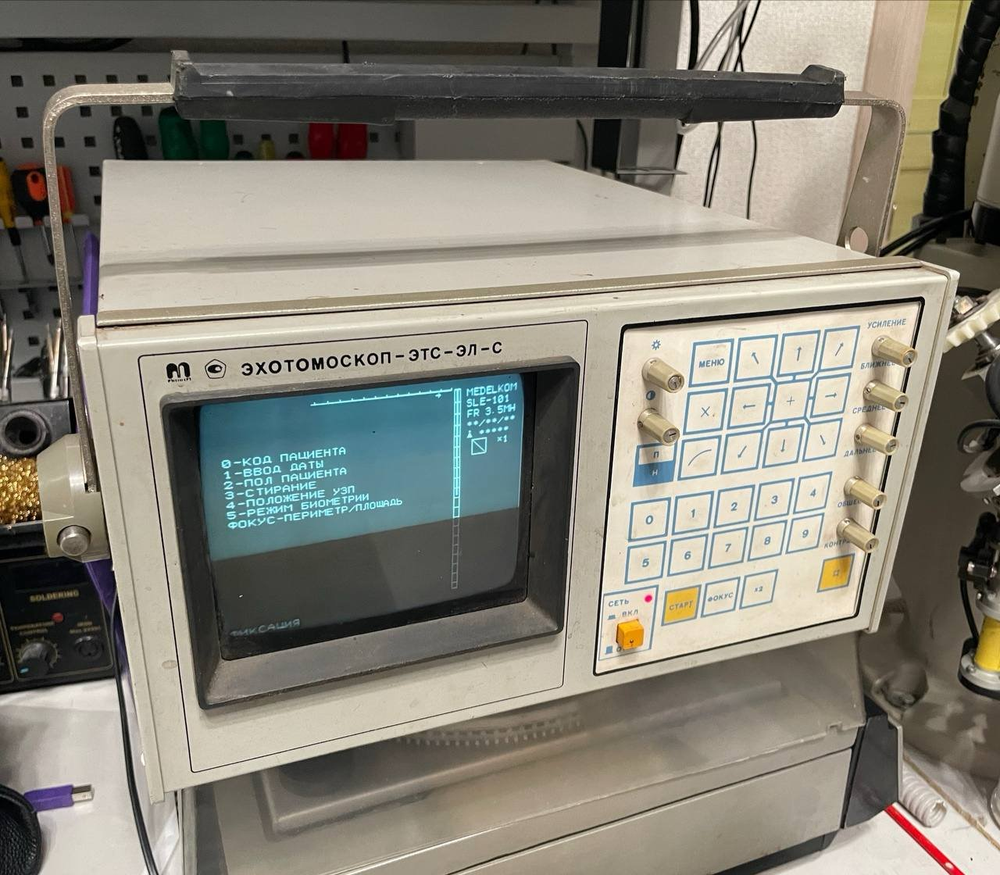
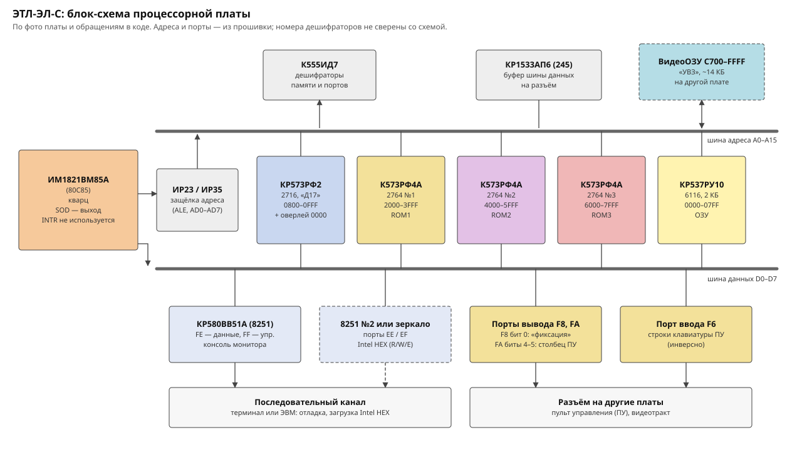
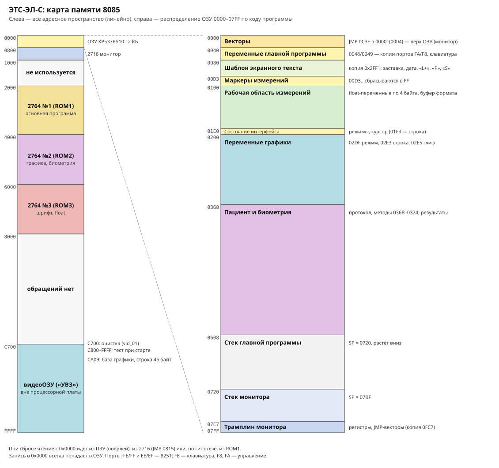
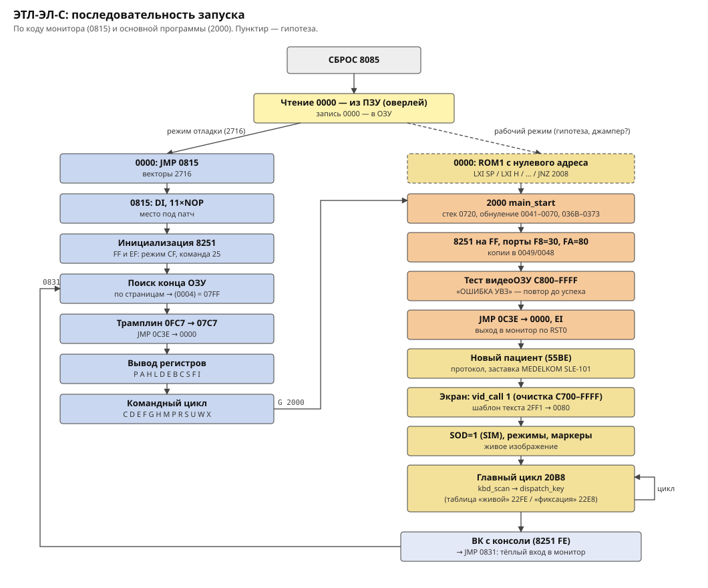
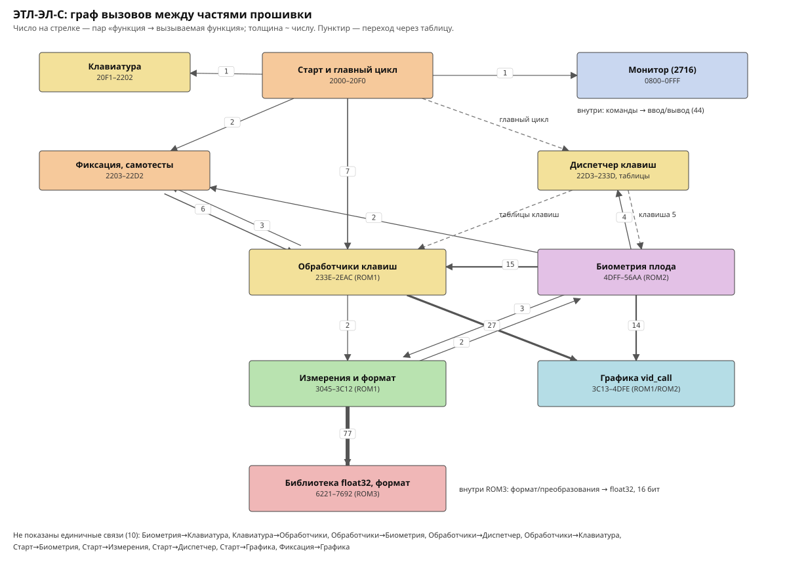
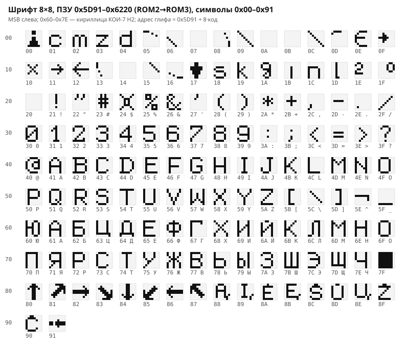
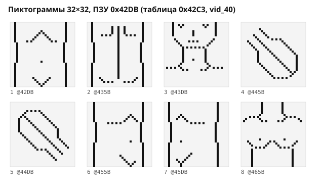

# ЭТС-ЭЛ-С (Меделком): прошивка процессорной платы

Разбор прошивки процессорной платы ультразвукового эхотомоскопа **ЭТС-ЭЛ-С** производства «Меделком».
На передней панели написано «ЭХОТОМОСКОП-ЭТС-ЭЛ-С», в прошивке прибор называется **MEDELKOM SLE-101**. Экземпляр рабочий, датчик прямой, 3,5 МГц. Плата датирована 09.92.



Процессор ИМ1821ВМ85А (КМОП-аналог 8085). Прошивка написана на ассемблере 8085 и занимает четыре ПЗУ:
монитор-отладчик в 2716 и основную программу в трёх 2764.

## История прибора

- **Производитель** — фирма «Меделком» (MEDELKOM), Вильнюс, Литва. Основана 16 ноября 1990 года
  «группой специалистов, имеющих многолетний опыт в разработках ультразвуковой диагностической аппаратуры».
  С 2013 года называется UAB «Medelcom International», торговая марка сохранена; фирма до сих пор выпускает
  УЗ-сканеры, датчики и видеокольпоскопы ([medelcom.lt](https://www.medelcom.lt/ru/about-us)).
- **SLE-101** — первый прибор фирмы: «портативный ультразвуковой сканер SLE-101 с линейным электронным сканированием»,
  разработан в 1990–1991 годах. Собственное производство сканеров фирма начала в 1992 году, датчиков — в 1993-м.
  По словам производителя, прибор был очень популярен до 1995 года благодаря характеристикам и низкой цене
  ([medelcom.lt](https://www.medelcom.lt/en/about-us), [LinkedIn](https://lt.linkedin.com/company/medelcom-international)).
  Плата этого экземпляра датирована 09.92, то есть это ранний серийный прибор.
- **ЭТС-ЭЛ-С** — русскоязычное название семейства SLE-101: в объявлениях встречается «Эхотомоскоп ЭТС-ЭЛ-С (SLE-101PC)»
  ([zhovta.ua](https://ru.zhovta.ua/ogol/prodaetsya-uzi-ehotomoskop-ets-el-s-sle-101pc-o259333)).
- **Модификации:** SLE-101M, SLE-101PC, SLE-101MF. У SLE-101PC — линейные, конвексные и микроконвексные датчики
  3,5–7,5 МГц, режимы B, B+B, M, B+M, глубина до 220 мм, 128 строк в кадре; измерения длины, площади, периметра,
  объёма эллипса и угла, акушерские и кардиологические расчёты
  ([medmax](https://medmax.com.ua/equipment/ultrasound/portable-ultrasound/sle-101pc.html),
  [bimedis](https://bimedis.com/medelkom-sle-101pc-m30486)). В прошивке этого экземпляра есть измерения длины,
  периметра и площади и акушерская биометрия; упоминаний режима M (строк, пунктов меню) не найдено.
- **Не подтверждено:** встречается утверждение, что SLE-101 выпускали три завода в России, Украине и Беларуси,
  но в первоисточниках компании его найти не удалось, названий заводов нет. Технической документации и схем
  на ЭТС-ЭЛ-С в открытом доступе не найдено.
- **Похожие названия:** советский стационарный эхотомоскоп ЭТС-ЭЛУ-01 (75 кг, датчики 3,5 и 5 МГц, режимы B и B+M,
  [zapadpribor](https://zapadpribor.com/ets-elu-01/)) и ЭТС-ЭЛ-01 — по найденным данным, другие приборы.

## Плата

| Элемент | Микросхема | Аналог |
|---|---|---|
| Процессор | ИМ1821ВМ85А | 80C85 |
| Последовательный порт | КР580ВВ51А | 8251 |
| ПЗУ монитора | КР573РФ2 («Д17») | 2716, 2 КБ |
| ПЗУ программы | 3× К573РФ4А | 2764, 8 КБ |
| ОЗУ | КР537РУ10 | 6116, 2 КБ |
| Логика | КР1533ИР23/ИР35, АП6, К555ИД7 и др. | 74ALS374/273, 245, 74LS138 |



## Порядок ПЗУ

| ПЗУ | Адрес | Файл | Содержимое |
|---|---|---|---|
| 2716 «Д17» | 0x0800–0x0FFF | `rom/u_0800_2716-monitor.bin` | Монитор-отладчик (команды как у Intel SDK-80, загрузка Intel HEX) |
| 2764 №1 | 0x2000–0x3FFF | `rom/u_2000_2764-1.bin` | Старт, клавиатура, меню пациента, измерения, начало графики |
| 2764 №2 | 0x4000–0x5FFF | `rom/u_4000_2764-2.bin` | Графика, пиктограммы, биометрия плода, начало шрифта |
| 2764 №3 | 0x6000–0x7FFF | `rom/u_6000_2764-3.bin` | Конец шрифта, арифметика float32 и вывод чисел; с 0x7693 пусто |

Как установлены адреса: переходы внутри каждой ПЗУ указывают на её же код только при этих базах;
шрифт без разрыва продолжается из ПЗУ №2 в ПЗУ №3; ПЗУ вызывают друг друга по абсолютным адресам.


## Карта памяти и запуск



- 0x0000–0x07FF — ОЗУ. При сбросе чтение по нулевому адресу идёт из ПЗУ (оверлей), запись — в ОЗУ.
- 0xC700–0xFFFF — видеоОЗУ на другой плате: графика 1 бит на точку, 360 точек в строке.
- Порты: FE/FF — 8251 (консоль), EE/EF — канал Intel HEX монитора, F6 — клавиатура пульта, F8/FA — управление.



В дампе на нулевом адресе стоит монитор, и ссылок на основную программу в нём нет.
Основная программа запускается либо командой `G 2000`, либо, по гипотезе, тем, что при сбросе на 0x0000
подставляется ПЗУ №1 (её первые 12 байт работают с любого адреса). Это нужно проверить по плате.

## Экран и пульт

Процессорная плата рисует только однобитную графику и текст (видеоОЗУ 0xC700–0xFFFF). Они накладываются
поверх аналогового УЗ-изображения. На фото выше:
- справа вверху — заставка «MEDELKOM SLE-101 FR 3.5MH», дата, код пациента и индикатор увеличения «x1»;
- сверху и справа — шкалы;
- в центре — меню, слева внизу — «ФИКСАЦИЯ».

Всё это совпадает с шаблоном экранного текста по адресу 0x2FF1, который при старте копируется в ОЗУ.

Пульт — матрица 4×8: столбец выбирается через порт FA, строки читаются из порта F6, коды берутся из таблицы 0x21D4.

| Клавиша | Код | Действие |
|---|---|---|
| 0–9 | 30–39 | пункты меню, ввод чисел |
| стрелки | 81–88 | перемещение курсора/маркера (коды 81–87 совпадают с глифами стрелок в шрифте) |
| МЕНЮ | 13 | меню «0-КОД ПАЦИЕНТА … 5-РЕЖИМ БИОМЕТРИИ» |
| СТАРТ | 1A | «живое» изображение ↔ «ФИКСАЦИЯ» |
| П/Н | 16 | позитив/негатив; в меню — выход |
| ФОКУС | 14 | зона фокусировки (3 положения) |
| ×2 | 11 (предположительно) | увеличение, индикатор «x1» |
| ×, «кривая», + | 10, 12, 15 | маркеры измерений (какой код у какой клавиши, пока не установлено) |

Порт F8 управляет видеотрактом: «живое»/фиксация, увеличение, позитив/негатив, фокус и щелчок при нажатии клавиши.
Подробности — в [docs/firmware_parts.md](docs/firmware_parts.md).

## Что умеет программа (по коду и строкам)

- «Живое» изображение и фиксация кадра.
- Код, пол и дата обследования пациента.
- Пиктограммы положения тела и датчика (УЗП), сдвиг по осям.
- Измерения: расстояние, периметр, площадь.
- Биометрия плода: GSD, CRL, BPD, HC, FL, TBD, APBD, AC, масса плода.
  Методы Hansmann, Hellman, Robinson, Kurtz, Hadlock, Jeanty, Fescina, Warsof — 13 кубических полиномов.
- Протокол обследования.

Все надписи — в КОИ-7 Н2, полный список — в [docs/strings.txt](docs/strings.txt).



## Шрифт

Шрифт 8×8 на 146 символов лежит по адресам 0x5D91–0x6220 и переходит из ПЗУ №2 в ПЗУ №3.
Адрес символа: 0x5D91 + 8·код.
- 0x00–0x1F — спецзнаки;
- 0x20–0x5F — ASCII;
- 0x60–0x7E — кириллица КОИ-7 Н2;
- 0x80–0x87 — стрелки в 8 направлениях;
- 0x88–0x91 — дополнительные знаки.



## Пиктограммы

Восемь картинок 32×32 точки (по 128 байт) по адресу 0x42DB. Через таблицу 0x42C3 их выводит графическая команда `vid_40`,
пункт меню «4-ПОЛОЖЕНИЕ УЗП». На них — схематичный контур тела, по которому отмечается положение датчика.
Текст на экране выводится прямо, как в таблице шрифта выше, то есть глифы хранятся сверху вниз.
Пиктограммы выводит другая процедура (`vid_40`), поэтому их ориентацию ещё нужно сверить с экраном (меню «4-ПОЛОЖЕНИЕ УЗП»).



## Содержимое репозитория

| Путь | Что там |
|---|---|
| `rom/` | Исходные дампы ПЗУ |
| `docs/firmware_parts.md` | Подробное описание частей, портов, памяти, открытые вопросы |
| `docs/serial_protocol.md` | Последовательный интерфейс: команды монитора, Intel HEX, утилита `tools/etl_serial.py` |
| `docs/display_custom_image.md` | План: вывод своей картинки/анимации на экран (видеоОЗУ, монитор, канал 8251) |
| `docs/*.svg` | Схемы (генерируются скриптами) |
| `disasm/` | Листинги Ghidra по каждой ПЗУ, список функций, порты, переменные ОЗУ |
| `parts/` | Прошивка, нарезанная на части (`index.txt` — оглавление) |
| `tools/` | Скрипты: проект Ghidra, разметка, экспорт, схемы; `etl_serial.py` — работа с прибором по 8251, `etl_sim.py` — эмулятор платы |

## Как пересобрать

Нужны JDK 21, Ghidra 12.x и `pip install pyghidra`.

```bash
export GHIDRA_INSTALL_DIR=~/ghidra_12.1.4_PUBLIC
python3 tools/ghidra_import.py      # проект ghidra/etl.gpr, блоки памяти, автоанализ
python3 tools/ghidra_annotate.py    # таблицы, имена, данные, строки (всё — из tools/etl_info.py)
python3 tools/gh_export.py          # disasm/
python3 tools/split_parts.py        # parts/
python3 tools/strings_koi7.py > docs/strings.txt
python3 tools/font2svg.py && python3 tools/rom_layout_svg.py && python3 tools/diagrams_svg.py && python3 tools/callgraph_svg.py
```

Проект Ghidra в git не хранится. После сборки его можно открыть в GUI: `ghidraRun` → `ghidra/etl.gpr`.
