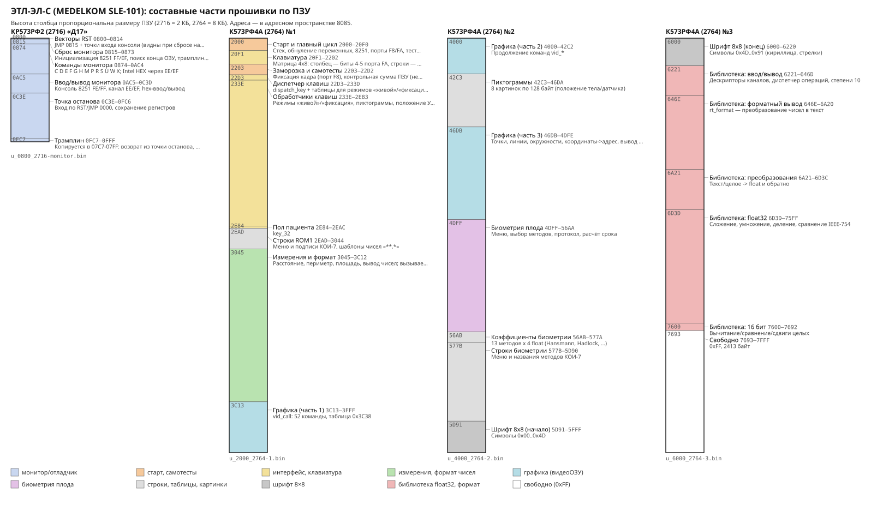

# Прошивка ЭТЛ-ЭЛ-С (MEDELKOM SLE-101): составные части

Разбор выполнен в Ghidra 12.1.4 (процессор `8085:LE:16:default`). Проект собирается скриптами
из `tools/` с нуля, листинги — в `disasm/`, нарезка по частям — в `parts/`.



Строка заставки в ROM1: **«MEDELKOM SLE-101 FR 3.5MH»** — заводское имя прибора, датчик 3,5 МГц.

## Порядок ПЗУ

| ПЗУ | Адрес | Файл | Назначение |
|---|---|---|---|
| КР573РФ2 (2716) «Д17» | 0x0800–0x0FFF (+ виден на 0x0000 при сбросе) | `rom/u_0800_2716-monitor.bin` | Монитор-отладчик |
| К573РФ4А (2764) №1 | 0x2000–0x3FFF | `rom/u_2000_2764-1.bin` | Основная программа, измерения, начало графики |
| К573РФ4А (2764) №2 | 0x4000–0x5FFF | `rom/u_4000_2764-2.bin` | Графика, пиктограммы, биометрия, начало шрифта |
| К573РФ4А (2764) №3 | 0x6000–0x7FFF | `rom/u_6000_2764-3.bin` | Конец шрифта, библиотека float/формата; 0x7693–0x7FFF свободно |

Три 2764 вызывают друг друга напрямую (ROM1→ROM3: 77 вызовов, ROM1↔ROM2: 42/43) и
считаются одной программой: ROM1 проверяет контрольную сумму 0x2000–0x7FFF целиком (`rom_checksum`, «ОШИБКА ПЗУ»).

## Части

### Монитор (2716)
| Адреса | Часть |
|---|---|
| 0800–0814 | Векторы: `JMP 0815` на сбросе, точки входа консоли (`JMP 0AEB/0AF9/0B07`) |
| 0815–0873 | Сброс: DI, 11×NOP (место под патч), инициализация двух 8251 (порты FF и EF: режим 0xCF, команда 0x25), поиск конца ОЗУ → (0004), копирование трамплина в 07C7–07FF, `JMP 0C3E` в 0000 |
| 0874–0AC4 | Командный цикл и команды (таблица 0x08A2) |
| 0AC5–0C3D | Ввод/вывод: консоль FE/FF, канал EE/EF, шестнадцатеричные числа |
| 0C3E–0FC6 | Вход по точке останова, сохранение регистров |
| 0FC7–0FFF | Трамплин (возврат к программе) и таблица JMP-векторов |

Команды монитора (набор как у монитора Intel SDK-80):
**C** сравнение блоков, **D** дамп, **E** конец файла Intel HEX, **F** заполнение, **G** запуск с точками останова,
**H** сумма блока, **M** пересылка, **P** флаги PSW (S Z A P C), **R** чтение Intel HEX с канала EE/EF,
**S** правка памяти, **U** перезапуск, **W** запись Intel HEX в EE/EF, **X** регистры (P A H L D E B C S F I).

### ROM1 — основная программа
| Адреса | Часть |
|---|---|
| 2000–20F0 | Старт: стек 0x0720, обнуление переменных, 8251, порты F8/FA, тесты, заставка, главный цикл |
| 20F1–2202 | Клавиатура: матрица 4×8 (столбец — биты 4–5 порта FA, строки — IN F6), «ЗАЖАТЫ КНОПКИ ПУ» |
| 2203–22D2 | Заморозка кадра «ФИКСАЦИЯ» (бит 0 порта F8), контрольная сумма ПЗУ, тест видеоОЗУ 0xC800–0xFFFF («ОШИБКА УВЗ») |
| 22D3–233D | `dispatch_key` и таблицы клавиш для «живого» и «замороженного» режимов |
| 233E–2EAC | Обработчики клавиш: меню «0-КОД ПАЦИЕНТА / 1-ВВОД ДАТЫ / 2-ПОЛ / 3-СТИРАНИЕ / 4-ПОЛОЖЕНИЕ УЗП / 5-РЕЖИМ БИОМЕТРИИ», пиктограммы, сдвиг по осям |
| 2EAD–3044 | Строки меню и шаблоны чисел (`**.*`) |
| 3045–3C12 | Измерения и вывод чисел: `fmt_value` + таблица из 11 форматов (0x3089), периметр/площадь, float-константы; считает через библиотеку ROM3 |
| 3C13–3FFF | Графика, ч. 1: `vid_call` — диспетчер 52 команд (A = номер, таблица 0x3C38) |

### ROM2
| Адреса | Часть |
|---|---|
| 4000–42C2 | Графика, ч. 2 (команды vid_*) |
| 42C3–46DA | Пиктограммы: таблица {номер,адрес} + 8 картинок 32×32 (см. [pictograms.svg](pictograms.svg)) |
| 46DB–4DFE | Графика, ч. 3: точки, линии, дуги, `vid_xy2addr`, вывод текста и символов |
| 4DFF–56AA | Биометрия плода: меню «1-ИЗМЕРЕНИЯ … 6-НОВЫЙ ПАЦИЕНТ», выбор методов, протокол |
| 56AB–577A | Коэффициенты: 13 методов × 4 float (кубический полином a+b·x+c·x²+d·x³) |
| 577B–5D90 | Строки биометрии |
| 5D91–5FFF | Шрифт, начало |

Методы (в порядке коэффициентов): GSD — Hansmann, Hellman; CRL — Hansmann, Robinson; BPD — Hansmann, Kurtz;
HC — Hadlock; FL — Hansmann, Jeanty; TBD — Fescina; APBD — Hansmann, Fescina; AC — Hadlock.
Масса плода (EFBW): Hansmann, Warsof.

### ROM3
| Адреса | Часть |
|---|---|
| 6000–6220 | Шрифт, конец (см. [font.svg](font.svg)) |
| 6221–646D | Рантайм: дескрипторы каналов (байт типа `ANI 17h / CPI 15h`, обработчик по адресу (BC+1)), таблица степеней 10 |
| 646E–6A20 | Форматный вывод чисел (`rt_format`) |
| 6A21–6D3C | Преобразования текст/целое ↔ float (предварительно) |
| 6D3D–75FF | Арифметика IEEE-754 single (предварительно: границы функций уточнить) |
| 7600–7692 | 16-битные вычитание, сравнение, сдвиги |
| 7693–7FFF | Свободно (0xFF, 2413 байт) |

Код ROM3 похож на рантайм компилятора языка высокого уровня: кадры стека `LXI H,-n / DAD SP / SPHL`,
float32, «файловые» дескрипторы. Какой это компилятор, пока не определено.

## Шрифт
8×8, MSB слева, 146 символов (0x00–0x91), база 0x5D91 (`font_ptr`: адрес = 0x5D91 + 8·код).
0x00–0x1F — спецзнаки, 0x20–0x5F — ASCII, 0x60–0x7E — кириллица КОИ-7 Н2, 0x80–0x87 — стрелки
в 8 направлениях, 0x88–0x91 — дополнительные знаки. Все тексты прошивки — в КОИ-7 Н2 с `$` на конце
([strings.txt](strings.txt)).

## Аппаратура (по коду)
| Порт | Направление | Назначение |
|---|---|---|
| FE / FF | IN/OUT | 8251 №1 — консоль монитора (данные/управление); основная программа: ВК с консоли → тёплый вход в монитор (0x0831) |
| EE / EF | IN/OUT | 8251 №2 — канал Intel HEX (команды R/W/E монитора); основная программа его не использует |
| F6 | IN | Строки клавиатуры (инверсные) |
| F8 | OUT | Регистр управления (бит 0: 0 = «ФИКСАЦИЯ», заморозка кадра); теневая копия в (0049) |
| FA | OUT | Столбец клавиатуры (биты 4–5) + управление; теневая копия в (0048) |
| SOD (SIM) | — | Выход SOD 8085 (`MVI A,C0 / SIM`) |

Память:
- 0x0000–0x07FF — ОЗУ КР537РУ10. Стек основной программы 0x0720 и ниже, 0x07C7–0x07FF — трамплин монитора.
- 0x0800–0x0FFF — монитор. 0x2000–0x7FFF — три 2764.
- 0xC800–0xFFFF — видеоОЗУ («УВЗ»): графика 1 бит/точку, строка 45 байт (360 точек), база графики 0xCA09, блоки по 36 строк.

Прерывания не используются: векторы в ОЗУ никто не устанавливает. Основная программа выполняет EI,
но обработчиков нет.

## Запуск основной программы — гипотеза
В мониторе нет ссылок на 0x2000. Но начало ROM1 (`LXI SP,0720 / LXI H,0041 / MVI A,30 / MVI M,0 / INX H / DCR A / JNZ 2008`)
выполняется правильно с любого адреса: после первого `JNZ 2008` управление переходит в настоящую ROM1.
Значит, при сбросе на 0x0000 может накладываться либо 2716 (режим отладки, `JMP 0815`), либо ROM1 (рабочий режим).
Выбор, вероятно, задаётся джампером на плате. Другой вариант — патч `JMP 2000` в 11 NOP по адресам 0816–0820.
Проверить по плате.

## Открытые вопросы
- Какой компилятор/рантайм в ROM3.
- Точные границы функций float-библиотеки, назначение 52 команд `vid_call`.
- Код без прямых ссылок: 0x255A, 0x32BB, 0x336C, 0x33D7, 0x4761, 0x4B7B, 0x4C68 — мёртвый или вызывается через указатели в ОЗУ.
- Внешние адреса 0x8000/0x8080/0xC700 (вне тестируемого видеоОЗУ) — что там.
- Схема оверлея 0x0000 и джамперы.

## Как пересобрать
```bash
export GHIDRA_INSTALL_DIR=~/ghidra_12.1.4_PUBLIC
python3 tools/ghidra_import.py      # проект ghidra/etl.gpr, блоки памяти, автоанализ
python3 tools/ghidra_annotate.py    # таблицы, имена, данные, строки (знания — tools/etl_info.py)
python3 tools/gh_export.py          # disasm/*.asm, functions.json, io_ports.txt, ext_refs.txt, ram_vars.txt
python3 tools/split_parts.py        # parts/*.bin
python3 tools/font2svg.py; python3 tools/rom_layout_svg.py; python3 tools/strings_koi7.py > docs/strings.txt
```
Проект Ghidra (`ghidra/`) в git не хранится. Открыть его в GUI: `ghidraRun` → File → Open Project → `ghidra/etl.gpr`.
