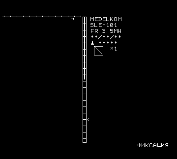

# Последовательный интерфейс ЭТС-ЭЛ-С

Всё восстановлено по коду монитора 2716 «Д17» ([disasm/mon_2716.asm](../disasm/mon_2716.asm))
и проверено на эмуляторе платы ([tools/etl_sim.py](../tools/etl_sim.py)) с настоящими дампами ПЗУ.
На живом приборе пока не проверялось.
Утилита для работы с прибором — [tools/etl_serial.py](../tools/etl_serial.py).

## Физический уровень

| | Консоль | Канал HEX |
|---|---|---|
| 8251 | №1, данные **FE**, управление **FF** | №2, данные **EE**, управление **EF** |
| Кто использует | монитор (команды, ответы); основная программа — только ВК | только монитор: команды R, W, E |
| Режим | `0xCF`: асинхронный, 8 бит, без чётности, **2 стоп-бита**, делитель **×64** | то же |
| Команда 8251 | `0x25`: TxEN, RxE, RTS (DTR не выставляется) | то же |

- Скорость = частота TxC/RxC ÷ 64. Источник такта на плате не установлен; 9600 бод соответствуют
  614,4 кГц. Подобрать скорость: `etl_serial.py -p PORT probe`.
- 8251 работает с ТТЛ-уровнями. Есть ли на плате формирователи RS-232 и куда выведены линии,
  нужно смотреть по плате. Если входы CTS/DSR 8251 не подтянуты, передатчик не работает.
- Монитор обменивается только 7-битными символами (`ANI 7Fh`), кодировка — ASCII.
- Аппаратного управления потоком нет. Программного тоже, есть только пауза (см. ниже).

## Консоль монитора

- Монитор сам выдаёт эхо каждого принятого символа. Приглашение — `ВК ПС -`.
  Ошибка — `+`, затем снова приглашение.
- Понимает только **заглавные** буквы и hex-цифры `0-9A-F`. Число может быть любой длины,
  учитываются последние 4 цифры.
- Параметры разделяются пробелом или запятой, после последнего ставится ВК. Пустой параметр
  или неправильное их число — ошибка.
- **^C** (0x03) при вводе прерывает команду (будет ошибка `+`).
- **Пауза.** Перед выводом *каждого* символа `con_putc` (0x0AF9) проверяет приёмник.
  Любой принятый байт останавливает вывод до следующего байта, а ^C прерывает команду.
  Отсюда главное правило для программы на ПК: **символы отправлять строго по одному
  и ждать эха, а пока монитор выводит, ничего не слать**. Иначе байты пропадают.
  Буфер у 8251 всего на один символ.
- Команды `P` и `U` параметров не читают и выполняются сразу по нажатию буквы. ВК после них
  монитор примет за «паузу».

### Команды

| Ком. | Формат | Действие | Вывод |
|---|---|---|---|
| C | `Cнач кон куда` | сравнить блок с блоком по адресу `куда` | на каждое расхождение строка `bb AAAA bb AAAA` (байт и адрес в `куда`, байт и адрес в блоке) |
| D | `Dнач кон` | дамп | `ВК ПС AAAA bb bb …`, новая строка с каждого адреса, кратного 16 |
| E | `Eадрес` | в канал HEX: запись конца `:00AAAA01cc ВК ПС` и `^Z` | — |
| F | `Fнач кон байт` | заполнение | — |
| G | `G[адрес][ т1[,т2]]` | запуск с сохранёнными регистрами; до 2 точек останова | после разделителя монитор выводит `-`; при останове — дамп регистров |
| H | `Hнач кон` | сумма байтов по модулю 256 | `bb` |
| M | `Mнач кон куда` | пересылка | — |
| P | `P` | флаги сохранённого PSW | `S=x Z=x A=x P=x C=x` |
| R | `Rсмещение` | приём Intel HEX из канала EE/EF, к адресам прибавляется смещение | ошибка контрольной суммы — `+` |
| S | `Sадрес зн зн …` | запись байтов подряд, старые значения не показываются | — |
| U | `U` | заново скопировать трамплин и сбросить регистры (без теста ОЗУ) | дамп регистров |
| W | `Wнач кон` | выдача блока в канал EE/EF в Intel HEX | — |
| X | `X` / `Xр` | `X ВК` — все регистры; `Xр` — показать `р` и ввести новое значение | ` P=0815 A=AA H=12 L=34 D=DD E=EE B=BB C=CC S=0760 F=FF I=00` |

Остальные буквы (A, B, I–L, N, O, Q, T, V) дают ошибку.

Подробности:

- **X.** После `Xр` монитор выводит ` значение-`. Дальше вводится новое значение и ВК
  (или пробел — оставить как есть). Затем монитор ждёт имя следующего регистра; ВК выводит
  все регистры и завершает команду. Регистр `I` — второй сохранённый PSW (на 80C85 SIM/RIM
  в трамплине заменены на NOP), поэтому `I` = `A`.
- **G.** Точка останова — байт `RST 0` (0xC7), записанный на место команды, поэтому точки
  работают **только в ОЗУ**. ROM-код основной программы так не отладить. При останове
  исходные байты восстанавливаются, PC корректируется на 1.
- **R.** Монитор ищет `:` и пропускает всё до него, поэтому ВК и ПС между записями не мешают.
  Тип записи данных не проверяется. Запись длиной 0 — конец файла, её адрес становится
  сохранённым PC (дальше `G` без адреса). Контрольная сумма записи конца не проверяется.
- **W.** Всегда пишет записи по 16 байт, поэтому последняя может выйти за `кон`.
  Записи конца W не выдаёт, для этого есть `E`.
- Сохранённые регистры и трамплин лежат в верхней странице ОЗУ: `07C7–07FF`. Стек монитора —
  ниже `07BF`. Значения после сброса — `P=0815 S=0760` и мусорные `AA/BB/…`.

### Точки входа для своих программ

Вектора в начале 2716 (по образцу Intel SDK-80):

| Адрес | Переход | Назначение |
|---|---|---|
| 0800 | 0815 | сброс монитора |
| 0803 | 0AEB | ввод символа с консоли → A |
| 0809 | 0AF9 | вывод символа из C на консоль (с проверкой паузы/^C) |
| 0812 | 0B07 | статус консоли: A=FF — есть символ, A=00 — нет |
| 0806, 080C, 080F | 0815 | не реализованы (сброс) |

Вернуться в монитор из своей программы: `RST 0` (байт `C7`). Через `JMP 0C3E`, который
монитор пишет в 0x0000, монитор сохранит регистры и выведет их дамп.

## Основная программа

Основная программа консоль не использует, но в главном цикле (0x20BF) опрашивает 8251 №1.
Принятый **ВК** передаёт управление «тёплому» входу монитора 0x0831: размер ОЗУ, трамплин,
дамп регистров, приглашение. Переменные основной программы (`0x0041–0x0720`)
и видеоОЗУ при этом сохраняются, так что их можно прочитать командой `D`. Вернуться — `G2000`
(холодный старт, экран перерисовывается).

## Утилита `tools/etl_serial.py`

Нужен `pip install pyserial`. Адреса и значения задаются в hex.

```
etl_serial.py -p /dev/ttyUSB0 probe                 # подобрать скорость
etl_serial.py -p /dev/ttyUSB0 -b 9600 monitor       # ВК → войти в монитор, показать регистры
etl_serial.py -p PORT regs                          # X + P
etl_serial.py -p PORT dump 0 7FF -o ram.bin         # ОЗУ (переменные основной программы)
etl_serial.py -p PORT dump 2000 3FFF -o rom1.hex    # сверить ПЗУ с дампом
etl_serial.py -p PORT screen -o screen.png          # снимок видеоОЗУ C700–FFFF (≈50 с при 9600)
etl_serial.py -p PORT load prog.hex --verify        # запись командой S (по консоли)
etl_serial.py -p PORT --aux /dev/ttyUSB1 load prog.hex --via aux   # командой R через EE/EF
etl_serial.py -p PORT setreg A=5 H=1 L=0
etl_serial.py -p PORT go 100 --bp 120 --wait 5      # запуск до точки останова
etl_serial.py -p PORT run-main                      # G2000
etl_serial.py -p PORT term                          # ручной терминал (miniterm)
etl_serial.py --sim …                               # то же на эмуляторе, без железа
```

Скорость передачи (9600 бод, посимвольно с ожиданием эха): чтение — около 3,3 символа на байт,
то есть ~300 байт/с; запись через `S` — 3 символа на байт плюс задержка на эхо.
Канал HEX (`--via aux`) работает потоком, без эха, и при больших объёмах быстрее.

В эмуляторе снимок экрана после заставки выглядит так (кадр повёрнут на 180°, как он,
видимо, и выводится на экран):



## Открытые вопросы

- Скорость (кварц/делитель для TxC 8251), уровни и разъём: где выведены FE/FF и EE/EF.
- Как вход в монитор при сбросе сочетается с автозапуском основной программы
  (джампер оверлея, см. [firmware_parts.md](firmware_parts.md)).
- Ориентация кадра на реальном экране: поворот на 180° выведен по тому, как прошивка рисует текст.
