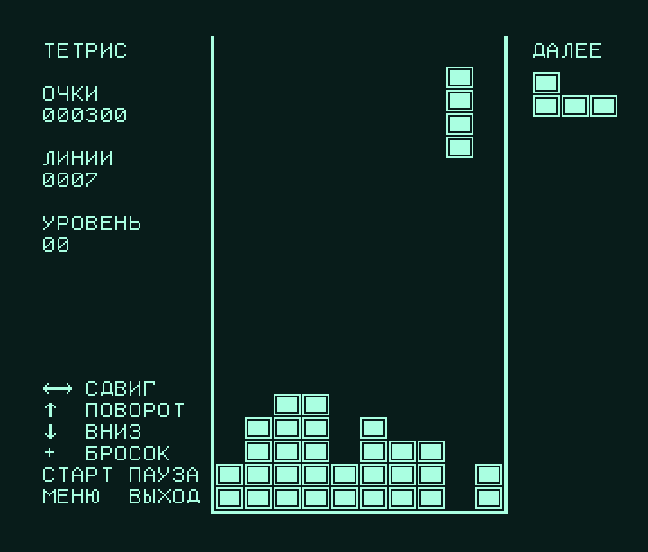

# Тетрис для ЭТС-ЭЛ-С

Тетрис для процессорной платы эхотомоскопа. Написан на ассемблере 8085. Работает в ОЗУ
платы, загружается через монитор 2716. Рисует прямо в видеоОЗУ, шрифт и коды клавиш берёт из ПЗУ прибора.



| Файл | Что это |
|---|---|
| [tetris.asm](tetris.asm) | исходный текст |
| [tetris.hex](tetris.hex) | готовый Intel HEX, 0040–071A |
| [tetris.lst](tetris.lst) | листинг с адресами |
| [test_tetris.py](test_tetris.py) | проверки на эмуляторе: линии, очки, уровни, стенки, конец игры |

## Управление (пульт)

| Клавиша | Код | Действие |
|---|---|---|
| ← → | 87, 82 | сдвиг; если держать — автоповтор |
| ↑, ↗ | 84, 81 | поворот по часовой стрелке |
| ↖ | 86 | поворот против часовой |
| ↓ | 85 | ускоренное падение |
| + (центр блока стрелок) | 10 | сбросить фигуру до упора |
| СТАРТ | 1A | начать игру / пауза |
| МЕНЮ | 13 | выход в основную программу (`JMP 2000`) |

Очки: 40, 100, 300 или 1200 за 1–4 линии, умноженные на (уровень + 1). Каждые 10 линий уровень
повышается, и фигуры падают быстрее.

## Сборка и эмулятор

```
python3 tools/asm8085.py tetris/tetris.asm --lst tetris/tetris.lst     # -> tetris/tetris.hex
python3 tetris/test_tetris.py
python3 tools/etl_gui.py --hex tetris/tetris.hex --go 40
```

В эмуляторе ([tools/etl_gui.py](../tools/etl_gui.py)) стрелки ПК работают как стрелки пульта.
Home/PgUp — это ↖/↗, пробел — «+», Enter — СТАРТ, Esc — МЕНЮ.

## Загрузка в прибор

Через монитор ([docs/serial_protocol.md](../docs/serial_protocol.md)):

```
python3 tools/etl_serial.py -p /dev/ttyUSB0 monitor                    # из основной программы — ВК
python3 tools/etl_serial.py -p /dev/ttyUSB0 load tetris/tetris.hex --verify
python3 tools/etl_serial.py -p /dev/ttyUSB0 go 40
```

Образ занимает 1755 байт. Командой `S` он загружается примерно за минуту, через канал HEX
(`--via aux`) — быстрее.

## Как устроено

- **Память.** Код с 0x0040: в 0x0000–0x0005 лежат переменные монитора, а RST-векторы
  игре не нужны (прерывания запрещены). Переменные идут сразу за кодом, стек начинается
  с 0x07C0, а трамплин монитора на 0x07C7–0x07FF не трогается.
- **Экран.** Байт столбца `bc` (0..44) экранной строки `sy` лежит по адресу `0xFFFF − 45·sy − bc`,
  старший бит — левая точка. Кадр повёрнут на 180°, строки выровнены по концу видеоОЗУ.
  Клетка стакана — 16×13 точек, стакан 10×20 клеток занимает строки 24–283.
- **Стакан хранится прямо в видеоОЗУ.** В ОЗУ всего 2 КБ, поэтому отдельного массива нет:
  клетка занята, если первый байт её кубика не 0. Перед проверкой фигура стирается.
  Полная линия убирается сдвигом куска видеоОЗУ.
- **Пульт** опрашивается так же, как в прошивке: столбец матрицы — биты 4–5 порта FA,
  строки читаются инверсно из F6. Коды берутся из таблицы ПЗУ `0x21D4`.
- **Текст** выводится шрифтом ПЗУ (`0x5D91 + 8·код`), надписи в КОИ-7 Н2. Ассемблер сам
  переводит кириллицу в строках `DB '…'`.
- **Щелчок** при падении фигуры — короткий 0 на бите 4 порта F8, как у прошивки при нажатии клавиши.
- Случайные фигуры — 16-битный РСЛОС. Пока на экране «НАЖМИТЕ СТАРТ», он прокручивается,
  поэтому каждая партия разная.

## Что не проверено на приборе

- **Направления стрелок.** Они выведены из кода прошивки, а не проверены на приборе. Обработчики
  `key_81…key_88` (0x2566–0x25C1) двигают маркер так, что коды образуют матрицу 3×3
  с «+» (код 10) в центре; это совпадает с блоком стрелок на фото пульта. Если направления
  перепутаны, нужно поменять `K_UP`, `K_DOWN`, `K_LEFT`, `K_RIGHT` в начале `tetris.asm`.
- **Скорость.** Частота процессора неизвестна. Кадр отсчитывается циклом задержки `FDEL`
  (≈20 мс при 3 МГц). Если игра идёт слишком быстро или медленно, поправьте `FDEL`.
- Видна ли графика поверх «замороженного» УЗ-изображения без датчика. Игра выставляет F8 = 30h и
  FA = 80h, как основная программа после старта, то есть режим «ФИКСАЦИЯ».
